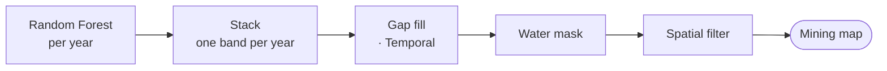

<p align="center">
  
  
</p>

# ⛏️ MapBiomas Ecuador – Mining

Google Earth Engine scripts used by **MapBiomas Ecuador** ([EcoCiencia](https://www.ecociencia.org/)) to map **mining** in Ecuador, year by year, from Landsat imagery. Mining is one of the **cross-cutting themes** of MapBiomas Ecuador and is mapped in Collections 3 and 4.

## 🌱 What is a cross-cutting theme?

Some land-cover classes are hard to separate in the general land-cover map. For them, MapBiomas develops **cross-cutting themes**: specific methods that map **a single class of interest** independently from the general map. During the **integration** of each collection, the result of each cross-cutting theme is incorporated into the final land-cover map using priority rules.

## 🏔️ Mining in Ecuador

Mining is mapped as **surface areas where material is extracted and the soil is left exposed**. Most of these areas in Ecuador correspond to **alluvial mining** (along rivers) rather than underground mining. The method is based on the experience of MapBiomas Brazil and was adapted in Google Earth Engine.

| Class | Value |
|---|---|
| Mining | `30` |
| Other | `27` |

More details in the Algorithm Theoretical Basis Document (ATBD): [ecuador.mapbiomas.org/atbd](https://ecuador.mapbiomas.org/atbd/).

## 🗂️ Collections

| Collection | Folder | Period | Status |
|---|---|---|---|
| Collection 3 | [`collection_3/`](collection_3/) | 1985–2024 | Published |
| Collection 4 | [`collection_4/`](collection_4/) | 1985–2025 | Published – see its [README](collection_4/README.md) |

## 🔁 Method

Mining is classified with **Random Forest**, year by year, only inside **areas of interest (ROI)** where mining is known or expected, one group of regions at a time. Training points (mining / not mining) are drawn by the analyst on the Landsat mosaics. The time series is then corrected with post-classification filters and a **water mask**: mining pixels that are water in the general land-cover map become "other", because mining pits and dredging areas are often confused with water.



| Step | Collection 3 | Collection 4 | What it does |
|---|---|---|---|
| Classification | `P01-classification.js` | `P01-classification.js` | Random Forest per year inside the ROI |
| Stack | `P02-stack-multiband.js` | `P02-stack-multiband.js` | One image with a band per year |
| Gap fill | `P03-gapfill-filter.js` | `P03-gapfill-filter.js` | Fills years with no mosaic data with the neighboring years |
| Temporal filter | `P04-temporal-filter.js` | `P04-temporal-filter.js` | Corrects interruptions of 1 to 3 years and the first and last years |
| Water mask | `P05-water-mask.js` | `P05-water-mask.js` | Mining over water (general map) becomes 27 |
| Spatial filter | `P06-spatial-filter.js` | `P06-spatial-filter.js` | Small patches (5 pixels or fewer in Collection 3, fewer than 5 in Collection 4) take the most frequent class of a 3 × 3 window |
| Final cleaning | – | `P07-remap-class-27.js` | Removes false positives inside polygons drawn by the analyst |
| Integration | – | `P08-integration.js` | National mining map |

In Collection 3, every year was classified in eight periods (1985–1992, 1993–1997, …, 2019–2023 and 2024). In Collection 4, the years 1985–2023 of the stack come from Collection 3, and only the newest years are classified again.

## 📂 Repository structure

```
ecuador-mining/
├── readme.md                     # This page
├── collection_3/                 # Collection 3
│   ├── P01-classification.js
│   ├── ...
│   └── P06-spatial-filter.js
└── collection_4/                 # Collection 4
    ├── README.md                 # Detailed description of each step and versions
    ├── P01-classification.js
    ├── ...
    └── P08-integration.js
```

## 🚀 How to use

1. Get a [Google Earth Engine](https://earthengine.google.com/) account and open the [Code Editor](https://code.earthengine.google.com/).
2. Choose the collection and open its scripts in order, or paste them into new scripts.
3. Edit the parameters at the top of each script and click **Run**.
4. For Collection 4, follow its [README](collection_4/README.md): it explains each step, the inputs and outputs, and the version numbers that connect the scripts.

## 🔗 Related

- MapBiomas Ecuador land-cover and land-use scripts (general map): `ecuador-lulc` repository.
- MapBiomas Ecuador platform: [ecuador.mapbiomas.org](https://ecuador.mapbiomas.org/).

## 👥 Authors

MapBiomas Ecuador team (EcoCiencia), with the MapBiomas Amazonía / RAISG development team.

### Contact and more information

This initiative is part of the MapBiomas Network, coordinated by MapBiomas Ecuador. More information at [ecuador.mapbiomas.org](https://ecuador.mapbiomas.org/).
