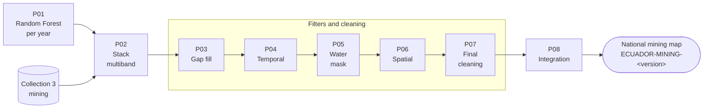

<p align="center">
  
  
</p>

# ⛏️ Mining – Cross-cutting Theme (Collection 4)

Scripts used by **MapBiomas Ecuador – Collection 4** to map **mining** (class `30`) year by year from 1985 to 2025, with Landsat mosaics and Google Earth Engine. The result is a national map with two classes: mining (`30`) and other (`27`).

## 🌎 Overview

Mining is classified only inside **areas of interest (ROI)** where mining is known or expected, one **group of regions** at a time (field `id_region` of the mining regions asset, e.g. regions 401 and 402 together, named `401-402`). The newest years are classified again and added to the Collection 3 series; the series is then corrected with filters, a water mask and a final manual cleaning.



| Class | Value |
|---|---|
| Mining | `30` |
| Other | `27` |

## 🔍 How each step works

| Script | What it does |
|---|---|
| **P01 – Classification** | Random Forest (100 trees) per year, only inside the ROI. The mosaic is the median of all satellites of the year, with 14 indices: `ndvi`, `ndfi`, `evi2`, `soil`, `savi`, `npv`, `soil_amp`, `nuaci`, `ndfib`, `gvs`, `gcvi`, `pri`, `ndwi_gao`, `ndwi_mcfeeters`. Training points are drawn by the analyst for a given year. Optional polygons force class 27, and Planet NICFI basemaps can be shown as reference. Exports the classification and the samples. |
| **P02 – Stack multiband** | Builds one image with a band per year: the years of Collection 3 (1985–2023), replaced by the new years classified with P01 (2024–2025). |
| **P03 – Gap fill** | Inside the classified area, empty values become 27. Years with **no mosaic data** become gaps and take the class of the next year (or, at the end of the series, of the previous year). |
| **P04 – Temporal filter** | Removes short interruptions of mining (1 to 3 years) and fixes the first and last years. |
| **P05 – Water mask** | In the selected years (2024–2025), pixels classified as mining that are **water** (class 33) in the general land-cover map become 27. Mining pits and dredging areas often contain water, which can be confused with mining. Polygons can protect areas where mining must be kept. |
| **P06 – Spatial filter** | Year by year, patches smaller than 5 pixels take the most frequent class of a 3 × 3 window. |
| **P07 – Final cleaning** | Inside polygons drawn by the analyst, every year becomes 27: false positives found after the filters are removed. |
| **P08 – Integration** | Mosaics the final version of every group of regions (`REGION_VERSIONS`); where groups overlap, the one listed last is kept. Everything else inside Ecuador becomes 27; pixels outside Ecuador are masked. |

**P03 in detail** (`-` = no mosaic data):

```
Input:   30 30  -  - 27 27  -
Output:  30 30 27 27 27 27 27
```

**P04 in detail** (rules applied in the order of `filterExecution`):

```
30 27 30          ->  30 30 30           middle3
30 27 27 30       ->  30 30 30 30        middle4 + middle3
30 27 27 27 30    ->  30 30 30 30 30     middle5 + middle4 + middle3
30 27 27          ->  27 27 27           first3 (class 27, first year)
30 30 27          ->  30 30 30           last3 (class 30, last year)
```

**P05 in detail:**

| Mining | Water map | Output |
|---|---|---|
| 30 | 33 (water) | 27 |
| 30 | other | 30 |
| 27 | any | 27 |


## 📂 Scripts

| Script | Input | Output |
|---|---|---|
| [`P01-classification.js`](P01-classification.js) | Mosaics, ROI, training points | `pathMinigClasificationPre` · `ECUADOR-<regions>-<year>-<v>` and samples (`pathMinigSamplesAct`) |
| [`P02-stack-multiband.js`](P02-stack-multiband.js) | Annual images of P01, Collection 3 | `pathMinigClasificationAct` · `ECUADOR-<regions>-<v>` |
| [`P03-gapfill-filter.js`](P03-gapfill-filter.js) | Output of P02, mosaics | `pathMinigClasificationFilterAct` · `ECUADOR-<regions>-<v>` |
| [`P04-temporal-filter.js`](P04-temporal-filter.js) | Output of P03 | same folder |
| [`P05-water-mask.js`](P05-water-mask.js) | Output of P04, general map (water) | same folder |
| [`P06-spatial-filter.js`](P06-spatial-filter.js) | Output of P05 | same folder |
| [`P07-remap-class-27.js`](P07-remap-class-27.js) | Output of P06 | same folder |
| [`P08-integration.js`](P08-integration.js) | Final version of every group of regions | `.../MINING/STEP04-INTEGRATION/ECUADOR-MINING-<v>` |

The asset folders (`path...`) come from the module `CollectionDirectories.js`.

### Versions

Each script reads the output of the previous one by **version number**. Default chain for one group of regions:

| Script | Reads | Writes |
|---|---|---|
| P01 | – | 998 |
| P02 | 998 | 997 |
| P03 | 997 | 996 |
| P04 | 996 | 995 |
| P05 | 995 | 994 |
| P06 | 994 | 993 |
| P07 | 993 | 992 |
| P08 | final version of each group | 1 |

P03 to P07 write to the **same folder**, so each one needs a different version number.

## 🚀 How to use

1. Sign in to the [GEE Code Editor](https://code.earthengine.google.com/).
2. Open the script from the repository `users/mapbiomasecuador/LULC` or paste it into a new script.
3. Set `regionIds` and the versions in `PARAMS`. Each parameter is documented in place.
4. Click **Run** and compare the layers **Mosaic**, **Original** and the result for the preview years. P04, P06 and P07 also print area charts (ha) in the console: input, result and Collection 3. They are computed at 250 m, so use them as a reference only.
5. Start the export from the **Tasks** tab.
6. Run P01 → P07 for each group of regions, then P08 once for the whole country.

**Drawn points and polygons.** Draw or import them in the Code Editor as FeatureCollections and pass their names in `PARAMS`:

| Script | Parameter | Properties |
|---|---|---|
| P01 | `roi` | – (classification only inside) |
| P01 | `miningPoints`, `otherPoints` | `id` (30 or 27) |
| P01 | `exclusion` | `id` = 27 |
| P05 | `keepAreas` | `id` = 1 (mining kept over water) |
| P07 | `remapAreas` | – (every year becomes 27 inside) |

The training points of P01 are drawn for a specific year: check that they are valid for the years being classified.

## 🧰 Requirements

- A [Google Earth Engine](https://earthengine.google.com/) account.
- Code Editor modules (loaded with `require`, must be public):
  - `users/mapbiomasecuador/LULC:COLECCION4/05-modules/CollectionDirectories.js` – asset paths.
  - `users/mapbiomasecuador/LULC:MODULES/Palettes.js` – Collection 4 color palette.
- Input assets: annual mosaics (LULC step 1), mining regions, Collection 3 mining classification, general land-cover map (water, P05), MapBiomas Ecuador Collection 3 map (charts), country boundary (P08).
- Optional: Planet NICFI basemaps (P01, P07) require access to the NICFI program.

## 👥 Authors

Fabricio Garcés and MapBiomas Ecuador team (EcoCiencia), with the MapBiomas Amazonía / RAISG development team.

### Contact and more information

This initiative is part of the MapBiomas Network, coordinated by MapBiomas Ecuador. More information at [ecuador.mapbiomas.org](https://ecuador.mapbiomas.org/).
